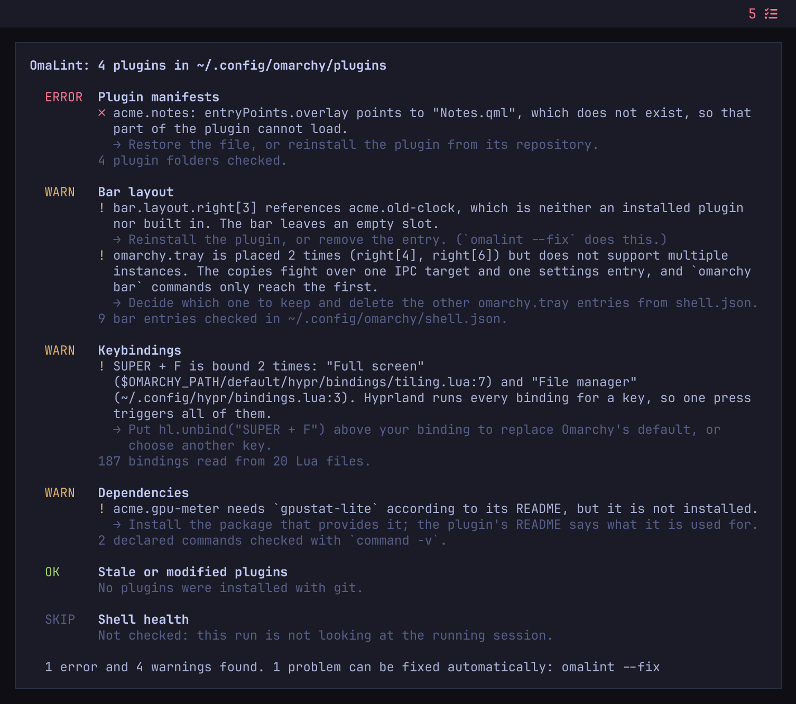
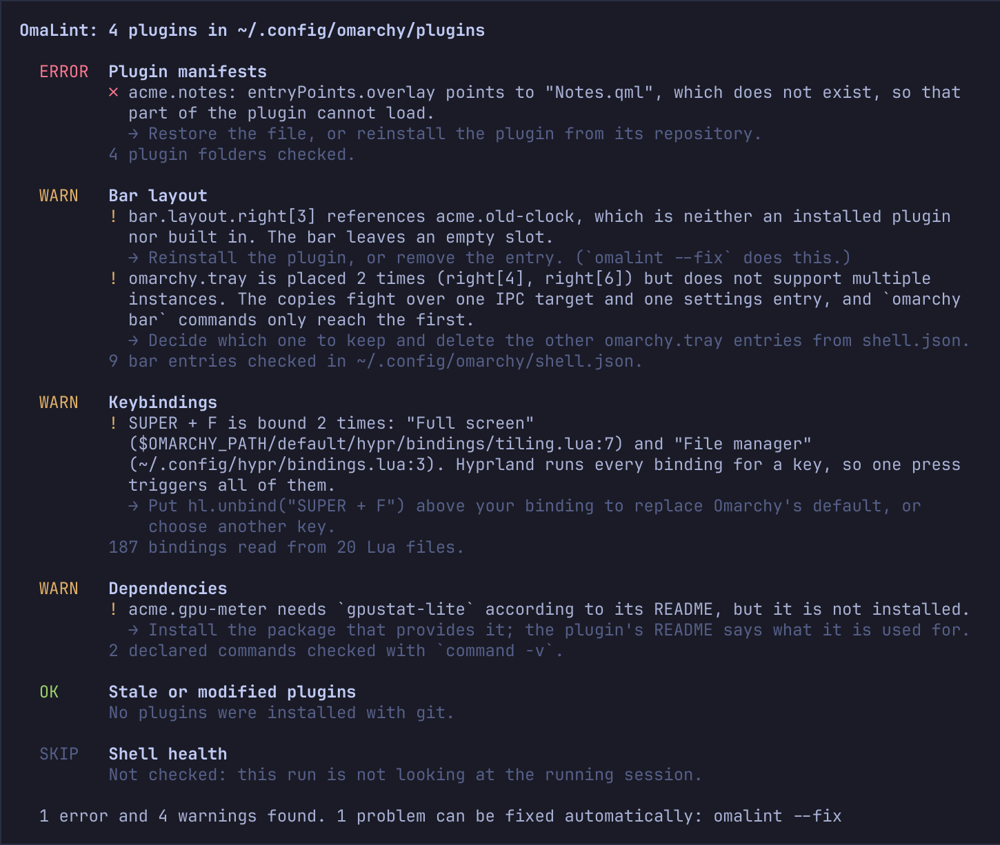

# OmaLint

A health check for your [Omarchy](https://omarchy.org) shell plugins and bar setup.

Install enough marketplace plugins and something eventually goes quietly wrong: a widget
leaves an empty slot on the bar, a key does two things at once, a plugin stops loading
after an update. The shell says so only in its log. OmaLint reads the same files the
shell reads, tells you in plain language what is wrong, and suggests the fix.



It is read-only. The one thing it will ever change is your `shell.json`, only when you
run `omalint --fix`, and only after saving a backup and showing you the diff.

## What you get

**A report you can read.** Run `omalint` and each check answers with OK, WARN or ERROR.
Every problem says what is wrong, where, and what to do about it, in plain language
rather than log lines.



**An icon on the bar when something is wrong.** The widget shows how many errors and
warnings were found, in the theme's urgent color when there are errors. Click it and the
report opens in a terminal. When there is nothing to report, it stays out of the way.


**A safe cleanup.** `omalint --fix` removes entries in `shell.json` that point at plugins
you no longer have, after saving a backup and showing you the diff.

Both pictures are made from the real program by `docs/screenshots.sh`, not drawn. The
report is the output of `omalint --no-live` on the made-up setup in `docs/sample`. The icon
is the real widget in an offscreen Quickshell, showing the count its own check produced
for that setup (1 error and 4 warnings). The shell health row says SKIP because a sample
folder is not a running desktop.

## What it checks

| Check | Finds |
|---|---|
| `manifests` | Plugin folders the shell cannot load: invalid JSON, wrong `schemaVersion`, missing fields, unusable or reserved `omarchy.*` ids, missing entry point files, two folders with the same id, a folder named differently from its id, symlinks |
| `bar` | `shell.json` entries that point nowhere: widgets and plugins that are not installed, widgets placed twice that do not support it, widgets in a section other than left/center/right, entries without an id, custom modules whose file is gone, a `shell.json` the shell ignores entirely |
| `keys` | Keys bound to two actions (in your Hyprland Lua config, against Omarchy's defaults, or by a plugin at run time), keys that open a plugin which is not installed or not enabled, and shortcuts a plugin's README suggests that are already taken |
| `deps` | Commands a plugin's README lists under Requirements that are not installed |
| `stale` | Git-installed plugins with local edits (which can stop `omarchy plugin update`), and plugin code that imports or loads files that no longer exist |
| `health` | Whether the shell is running, whether it has picked up every installed plugin, and which plugins have logged errors since it started |

Each finding is an **ERROR** (something is broken), a **WARN** (something is wrong but
the shell copes), or a note (worth knowing, nothing to do).

## Requirements

- Omarchy 4 (the Quickshell-based shell)
- `python3`, which Omarchy ships. OmaLint uses only the standard library and runs `/usr/bin/python3`.

It also uses these when they are present. Without one, the part of the report that needs
it is skipped and says so. All of them are part of an Omarchy install:

- `git`, optional, only for the local-edits check
- `journalctl` and `omarchy-shell`, optional, only for the shell health check
- `hyprctl`, optional, only to see keybindings registered at run time
- `pacman`, optional, only to recognise a requirement that names a package instead of a command

No pip packages, no daemon, no network access, no elevated privileges.

## Install

```bash
omarchy plugin add https://github.com/DavidGudovic/omalint.git
```

Omarchy clones the repository into `~/.config/omarchy/plugins/io.github.davidgudovic.omalint/`
and asks whether to enable it. Answer no if you would rather read the code first; the
command below works either way.

To use the command from anywhere, link it into `~/.local/bin` (already on `PATH` in Omarchy):

```bash
ln -s ~/.config/omarchy/plugins/io.github.davidgudovic.omalint/bin/omalint ~/.local/bin/omalint
```

To put the widget on the bar later (optional):

```bash
omarchy plugin enable io.github.davidgudovic.omalint
```

Nothing on the bar after enabling it? That is the healthy state: the icon only shows when
there is something to report. Turn on `alwaysShow` (see below) to keep it visible. You can
also read the report without the `~/.local/bin` link:
`omarchy-shell io.github.davidgudovic.omalint report` opens it in a terminal once the
plugin is enabled.

## Usage

```bash
omalint                    # the full report
omalint --only bar,keys    # just these checks
omalint --skip health      # everything but this one
omalint --json             # the same report, for scripts
omalint --fix --dry-run    # show what --fix would change
omalint --fix              # remove dead shell.json entries (backup + diff)
omalint --strict           # also exit 1 when there are warnings
omalint --rules            # also print each finding's rule
omalint --ignore RULE      # hide a finding you have accepted
```

Exit status is `0` when there are no errors, `1` when there are (so it can gate a hook
or a CI job), and `2` when OmaLint itself could not run.

`--config-dir`, `--hypr-dir` and `--omarchy-path` point it at another setup, such as a
dotfiles checkout in CI. Pointed away from your own session, or run with `--no-live`, it
does not query the running shell, the journal or Hyprland. Setting `OMALINT_NO_LIVE=1` in
the environment does the same as `--no-live`.

For example, to be told after every `omarchy update` if something broke, save this as a
file named `omalint-after-update`:

```bash
#!/bin/bash
omalint --skip health >/dev/null ||
  omarchy-notification-send "OmaLint found plugin errors" "Run omalint for the report"
```

and install it with `omarchy hook install post-update omalint-after-update`. Omarchy
copies it into `~/.config/omarchy/hooks/post-update.d/`; delete it there to undo.

## What `--fix` does

`--fix` repairs one kind of problem: entries in `~/.config/omarchy/shell.json` that the
shell already ignores. It removes

- bar entries for widgets that are not installed,
- bar entries without an id,
- `plugins` entries for plugins that are not installed,
- a `bar.id` naming a bar that is not installed.

The bar looks the same before and after. Before writing, it copies the file to
`shell.json.bak.omalint.<timestamp>` next to it and prints a unified diff; the output
ends with the `cp` command that undoes the change.

It is deliberately cautious. It leaves an entry alone when the plugin might be broken
rather than gone, never removes anything in the `omarchy.*` namespace, and does not
touch a widget that is placed twice, because the bar draws both copies and which one
stays is your call. In each case the report says why.

Everything else in the report comes with a suggestion but is yours to fix: OmaLint
never edits plugin code, your Hyprland config, or anything under `/usr/share/omarchy`.

## Ignoring a finding

Some findings you will decide to live with, such as a plugin you edited on purpose. So that
they do not keep the icon on the bar forever, you can ignore them.

Every finding has a rule: a code, plus the thing it is about. `omalint --rules` prints it
under each finding:

```
rule: stale.local-changes:zeru.portwatch
```

List the rules you accept in the widget's `ignore` setting, separated by commas. The
command and the bar icon both read it:

```bash
omarchy bar set io.github.davidgudovic.omalint ignore "stale.local-changes:zeru.portwatch"
```

The code alone (`stale.local-changes`) ignores every finding of that kind. For a single
run, `omalint --ignore RULE` does the same without changing any setting.

An ignored finding is not counted, does not affect the exit status, and `--fix` leaves it
alone. It is still listed, on an `Ignored:` line under its check, so nothing disappears
without a trace. To stop ignoring it, remove the rule from the setting.

## The bar widget

One background service per shell runs the same checks (ten seconds after the shell starts,
then every 30 minutes), however many monitors you have. It also checks again a second
after `shell.json` changes, so the count follows a fix. The widget on each bar shows its
result: a checklist icon with the number of errors and warnings (the icon alone on a
vertical bar). With errors it takes the theme's urgent color. With nothing to report it
stays off the bar, like Omarchy's own update indicator.

- Left click opens the report in a floating terminal.
- Right click checks again now.

Settings, in the widget's `shell.json` entry or with `omarchy bar set`:

| Key | Default | Meaning |
|---|---|---|
| `alwaysShow` | `false` | Keep the icon on the bar when no problems are found |
| `refreshIntervalSec` | `1800` | Seconds between background checks (minimum 60) |
| `ignore` | `""` | Rules of findings to hide, comma-separated (see "Ignoring a finding") |

```bash
omarchy bar set io.github.davidgudovic.omalint alwaysShow true
omarchy bar set io.github.davidgudovic.omalint refreshIntervalSec 600 --json
omarchy-shell io.github.davidgudovic.omalint refresh    # re-check now
omarchy-shell io.github.davidgudovic.omalint report     # open the report
```

## What it reads, runs and writes

OmaLint reads `~/.config/omarchy/shell.json`, the folders in `~/.config/omarchy/plugins/`,
the Lua files your `~/.config/hypr/hyprland.lua` loads, and Omarchy's own defaults under
`$OMARCHY_PATH`.

It runs these local, read-only commands: `sh -c 'command -v …'`, `pacman -Qq`,
`git --no-optional-locks status` in each plugin checkout, `omarchy-shell shell ping`,
`omarchy-shell shell listPlugins`, `hyprctl -j binds` and `journalctl --user -t omarchy-shell`.
It never fetches, never contacts a network, and sends nothing anywhere.

It writes nothing, with one exception: `omalint --fix` rewrites `shell.json` and leaves
a `shell.json.bak.omalint.<timestamp>` backup beside it. There is no cache, no state
directory and no log file.

## Remove

```bash
omarchy plugin remove io.github.davidgudovic.omalint
rm -f ~/.local/bin/omalint
rm -f ~/.config/omarchy/shell.json.bak.omalint.*    # backups from --fix, if you ran it
```

`omarchy plugin remove` takes the widget off the bar and deletes the plugin folder. The
two `rm` lines cover the only other files OmaLint can have created.

## How sure is it

The `manifests` and `bar` checks follow the rules of the shell's plugin registry and of
`omarchy plugin validate`, taken from Omarchy's own source. The others read things that
were not written for a machine, and say less when they are less sure:

- **Keybindings** are found by scanning Lua for `o.bind`, `hl.bind` and `hl.unbind` calls
  with literal keys, following `require` in load order. Bindings built in loops or from
  variables are not seen. When Hyprland is running, its own binding table has the last
  word, which also catches shortcuts plugins register at run time. Keys bound by keycode
  (`code:38`) are compared with each other but not with their named equivalents.
- **Dependencies** come from the README, since manifests have no dependency field. Only
  `backticked` names in the lists and tables of a Requirements, Dependencies or
  Prerequisites section count, and anything described as optional becomes a note. A
  backticked word that is not a program can still be mistaken for one.
- **Missing files** are literal paths in `import "…"`, `Qt.resolvedUrl("…")` and
  `source: "…"`. Paths assembled at run time are not checked.
- **Log errors** are warnings and errors the shell logged about a plugin since the shell
  process started. Restart the shell (`omarchy restart shell`) to clear old ones.

## Development

```bash
bash tests/run.sh           # all tests
bash docs/screenshots.sh    # regenerate the images in this README
```

The tests use only the standard library and the fixtures in `tests/fixtures/`: a small
stand-in Omarchy install, a healthy setup, a broken one with one problem per plugin, and
one with only the problems `--fix` repairs. One test mounts the service and two copies of
the widget in an offscreen Quickshell, the way a two-monitor bar does; it is skipped where
Quickshell or the Omarchy shell's files are missing. Both commands work in a temporary
home and never read or write your own configuration.

## License

MIT. See [LICENSE](LICENSE).
